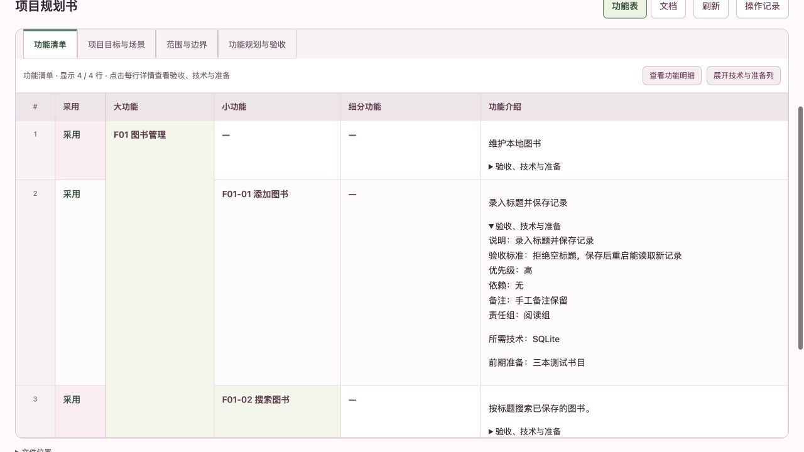

# 台账目标同步与功能详情去重：修复及复验

本次两个问题已修复，独立对抗性审核 **95/100，通过**。修复提交 `d335776`，基线 `fcc2862`。本报告只关闭 F09-07 的 T01/T02，不表示历史体验待办全部完成。

## 改动与边界

1. **台账目标跟随规划。** 按当前规划生成候选时读取明确的项目目标；显式保存台账后落盘。二次修改规划目标、重新生成和保存也能同步。缺少明确目标时保留原值；其他头部信息、实施字段及历史保持。目标中的管线和反斜杠按 Markdown 编码，重复转换不增加尾部。仅保存规划不直接覆盖台账，符合既有预览与确认流程。
2. **功能详情字段各归其位。** 解析明确的采用、技术、准备列，不再先拼入备注再从备注反向提取。功能清单展开详情中的技术、准备各显示一次；明细和 Excel 各有独立列。真实备注、自定义列、多行值及旧技术/准备列名继续保留，空采用值统一默认“是”。用户手写的同名说明不被擅自删除。

执行者为 `/root/fix_ledger_goal_sync`、`/root/fix_feature_detail_fields`，协调与成品复验为 `/root`。没有恢复网页写入或模型对话功能，没有改动用户业务项目。

## 最终验证

| 检查 | 结果 | 原始证据 |
| --- | --- | --- |
| Python 全量 | 210 项通过 | [命令与退出码](goal-detail-repairs/core/results.json)、[完整输出](goal-detail-repairs/core/01-python.stderr.log) |
| 前端脚本 | 8 份 CJS 全通过，含真实 Python 投影至实际 JS 渲染器 | [日志目录](goal-detail-repairs/core/) |
| 两套实际 ZIP | Codex、Claude Code 包各 26 次 tools/call，共 52 次；8 次只读 HTTP 全部 200 | [协议报告](goal-detail-repairs/packages/integration-evidence.json)、[原始应答](goal-detail-repairs/packages/stdio-raw-transcript.jsonl) |
| 独立对抗性审核 | 13 项 Python、实际 JS 渲染检查及 4 组编码语义检查通过；95/100 | [独立报告](goal-detail-repairs/review/REVIEW.md)、[被测源码哈希](goal-detail-repairs/review/final-run.json) |
| 实际网页 | 1280×720，项目总览起步，13 次点击、14 张截图 | [观察记录](goal-detail-repairs/browser/observations.json)、[总览1](goal-detail-repairs/browser/overview-1.jpg)、[总览2](goal-detail-repairs/browser/overview-2.jpg)、[总览3](goal-detail-repairs/browser/overview-3.jpg) |
| 浏览器 Excel 下载 | 文件正常，技术/准备/采用列唯一，目标和采纳后验收正确，备注与自定义字段保留 | [下载检查](goal-detail-repairs/browser/download-check.json)、[实际文件](goal-detail-repairs/browser/downloaded-plan.xlsx) |

独立测试在旧版运行时 13 项中 12 项失败、1 项“缺目标保留”通过；旧版详情渲染明确得到重复计数 `2 !== 1`。负对照说明测试能抓住原问题。独立审核随后发现混合目标表误取范围、含保留词的目标分隔符重复、空采用值跨视图不一致，修正后重新验证通过。早期失败与返工日志一并保留，未把中途结果当作最终通过。

两套 ZIP 都实际解压，核对 inventory 和运行时源码字节后，通过各自 `.mcp.json` 启动 stdio。路线是：新建隔离项目→保存规划→生成并保存台账→新增搜索及作者筛选子项→修改项目目标→记录并采纳测试建议→保存规划→重新生成并保存台账→历史→Excel→只读网页。每次预览均未提前写盘；最终清单四行、有效叶两项、完成零项；最早规划副本字节保持不变。建议来自明确标注的测试夹具，未冒称模型分析或真实业务验收。

首次成品脚本误把 Excel 首行合并标题当作表头，并按数组位置读取有合并单元格的行，测试脚本因此失败。改为识别实际表头及单元格坐标后，两包从头重跑通过；[更正记录](goal-detail-repairs/packages/harness-correction.json)和[first-harness-attempt](goal-detail-repairs/packages/first-harness-attempt/)保留。此为测试脚本错误，不记为产品缺陷。

## 网页亲测

使用最终 Codex ZIP 的只读服务器和隔离数据，逐次点击前截图，最后补终态截图：

项目总览→查看规划→展开“添加图书”→技术与准备列→当前项目目标→功能明细→下载 Excel→操作记录→最早功能表→旧目标→返回记录→看板→搜索图书→作者筛选详情。

- 截图 03：技术 `SQLite`、准备“三本测试书目”在展开详情里各一次；“手工备注保留”和“责任组：阅读组”仍在。
- 截图 05：当前目标是“帮助读者按标题和作者快速查找已保存的图书。”；截图 10 的旧目标仍是“让读者保存本地图书清单。”。
- 截图 09 的历史清单两行，当前清单四行；旧副本没有被新目标或建议覆盖。
- 截图 12–14：看板仍按大功能包含子功能展示，有效叶两项、完成零项，父项展开优先呈现子项。
- 浏览器警告/错误记录为空。测试标签已关闭、窗口尺寸已恢复，端口 63553 的测试服务已停止；首次退出检查过早，随后确认端口关闭，见[清理记录](goal-detail-repairs/browser/server-stopped.json)。

## 包与未验证范围

本地三 ZIP 已重建；精确 SHA-256 及源码哈希见[元数据](goal-detail-repairs/metadata.json)。独立审核最后再次确认生产 Python 文件及 JS 与其通过时哈希一致。版本仍为 0.2.0，本轮没有推送、发布或安装到真实宿主。

- 本轮未重新调用真实 Codex/Claude 模型，也未测试真实 Claude Code 安装与升级；协议测试不能代替宿主验收。
- 未重新进行 GitHub 搜索、源码克隆核对流程；本次变更为本地转换和只读字段投影。
- Excel 检查到下载文件及 XML，未在原生 Excel 打开；长合并组专项仍待审核。
- 网页本轮只验 1280×720，未重跑手机、键盘或整套新人体验审计。
- 两处 `planning_model` 仍有相似代码，目标解析复用内部 Markdown 分块；任意非标准手写格式未穷举。独立评分分项为 40/29/18/8，扣分理由见独立报告。

已有项目总台账保持 43/46；仅关闭两个明确子问题，不新增虚假完成数。
