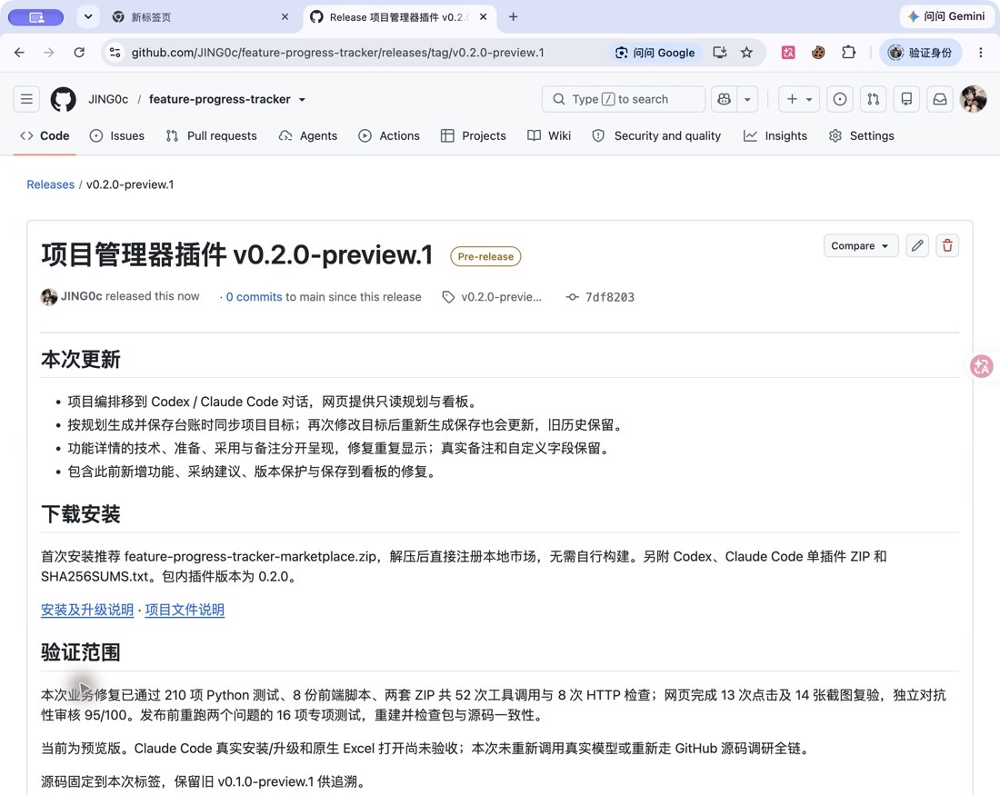

# 0.2.0 预览插件发布验证

已按用户授权推送本次修复并发布 [v0.2.0-preview.1](https://github.com/JING0c/feature-progress-tracker/releases/tag/v0.2.0-preview.1)。Release ID `443940912`，非草稿、预览版；内部插件版本为 `0.2.0`。发布时间为 2026-11-12 23:37 PST（UTC 2026-11-13 07:37）。

## 代码与安装包

- 源码推送到 [feat/chat-project-orchestration](https://github.com/JING0c/feature-progress-tracker/tree/feat/chat-project-orchestration)。
- 发布标签固定到 `7df820349f43c3a48fa0c9ab6d1e3eecbe482394`，含修复 `d335776`、复验记录 `b29f113` 和下载说明 `7df8203`。此后的发布证据提交不改已发布包，不移动标签。
- 保留旧 `v0.1.0-preview.1` Release 和附件，没有强制推送或改写旧标签；本轮未合并主分支。
- 用户可直接下载完整市场包，无需自行构建。三个 ZIP 外另附 `SHA256SUMS.txt`。

| 附件 | 字节数 | SHA-256 |
| --- | ---: | --- |
| [完整双宿主市场（推荐）](https://github.com/JING0c/feature-progress-tracker/releases/download/v0.2.0-preview.1/feature-progress-tracker-marketplace.zip) | 263502 | `cbc268a87ff7ec934d29f08a839b0860bcbae2a32a6544aa70735656b1a0ecb2` |
| [Codex 插件](https://github.com/JING0c/feature-progress-tracker/releases/download/v0.2.0-preview.1/feature-progress-tracker-codex.zip) | 130942 | `a3f3547a034d4b05e769f9da14da82ab1c22750c0a172345e3bc5676533900a4` |
| [Claude Code 插件](https://github.com/JING0c/feature-progress-tracker/releases/download/v0.2.0-preview.1/feature-progress-tracker-claude.zip) | 129591 | `cac96d0b7275ceb299fe1fa126c7ff4bd69680eed83194d14fd81a86b7e1765a` |

## 验证

1. 根 Agent 重跑目标同步 9 项、详情字段 7 项专项测试，全部通过；本轮不修改产品运行代码。此前完整修复复验见[目标与详情修复报告](2026-11-12-goal-detail-repairs.md)。
2. 更新下载说明后重建三 ZIP；独立 Agent 在另一临时目录重建，三个结果 SHA 完全相同。清单、包内技能/运行代码/文档与发布源码逐字节一致，完整市场内插件与单包一致，无用户项目、测试资料、密钥或缓存。
3. 独立运行 11 项打包测试通过，含解压双宿主完整代码流程及只读服务；另对待发布 ZIP 自写 16 次 MCP 调用，目标同步、候选不提前写盘、保存和 Excel 字段去重通过。
4. 根 Agent 通过 GitHub 网页上传四个附件，选择预先推送的现有标签后发布。页面显示正确提交 `7df8203`、预览标记及四附件。上传自动形成的发布草稿已发布为本次 Release。
5. 根 Agent 从公开下载地址重新下载四个附件，逐字节与本地 `dist/` 文件比较，全部一致；三 ZIP 的 CRC 正常。Release API 的 size 和 SHA-256 digest 也一致。
6. 独立 Agent 再从公开 API 核对非草稿/预览状态、annotated tag 实际目标及四附件元数据；标签下 README 和安装说明均 HTTP 200、内容与本地相同。

独立审核 `/root/release_package_review`，最终 **97/100（40/29/19/9），发布范围通过**。未穷举不同操作系统解压行为，未重新安装真实 Codex/Claude 宿主或运行模型，也未用原生 Excel 打开；包和远端发布通过不代替这些产品验收，F11-01 仍待审核，总体 43/46 不变。

证据：[实际下载核对](plugin-release-020/download-verification.json)、[Release API](plugin-release-020/release-api.json)、[独立审核](plugin-release-020/independent/REVIEW.md)、[专项回归](plugin-release-020/focused-regression.json)、[校验文件](plugin-release-020/SHA256SUMS.txt)。根 Agent 执行上传，独立 Agent 不参与发布；实际附件正文下载由根 Agent完成，独立 Agent 检查 API 元数据。

